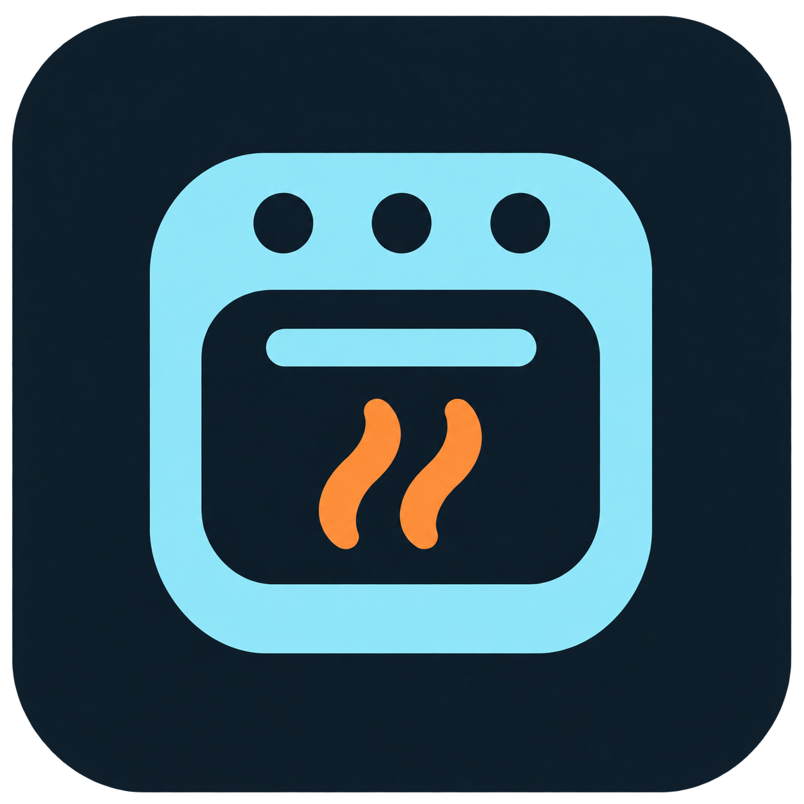
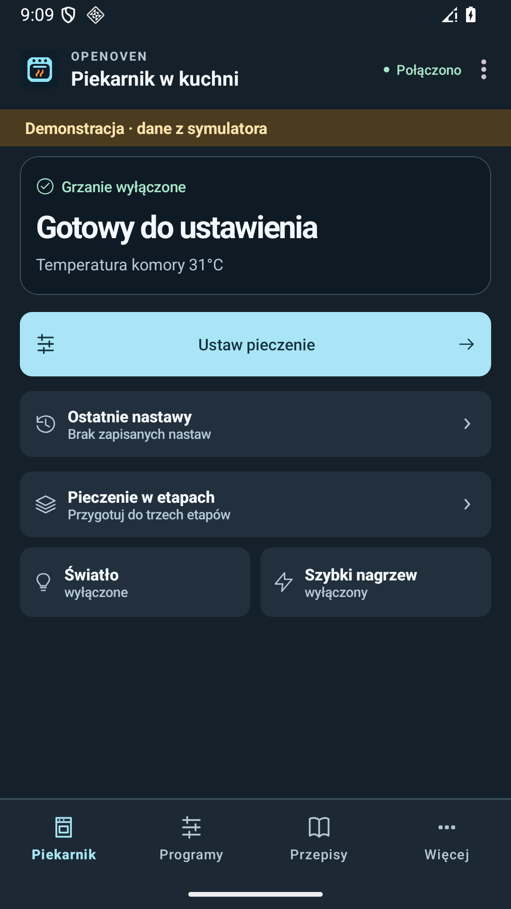
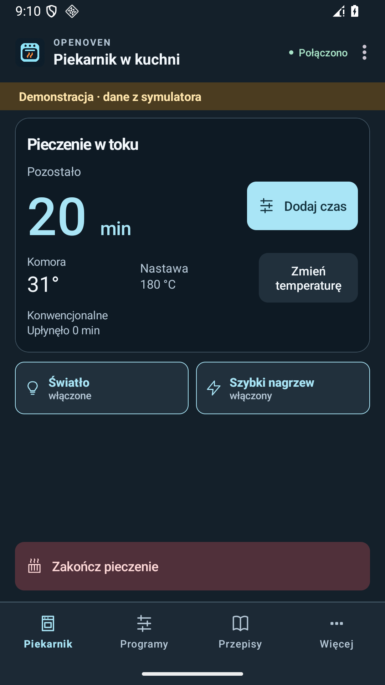
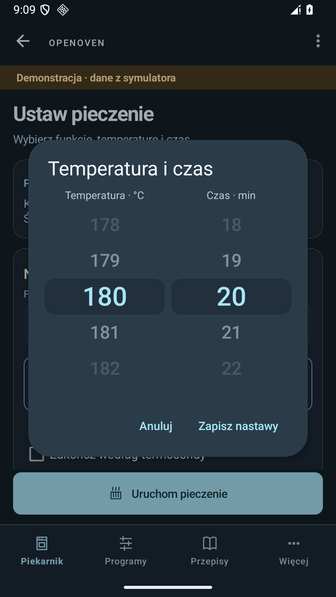

<p align="center"></p>

<h1 align="center">OpenOven</h1>

<p align="center">Niezależna aplikacja na Androida do lokalnego sterowania kompatybilnymi piekarnikami Amica. Alternatywa dla aplikacji producenta, z własnymi przepisami, edytowalnymi nastawami i szybkim dostępem do funkcji pieczenia.</p>

<p align="center"><a href="https://github.com/techparka/openoven/releases/latest"><strong>Pobierz APK</strong></a> · <a href="#pierwsze-połączenie">Pierwsze połączenie</a> · <a href="#zakres-testów">Zakres testów</a> — <a href="docs/index.html">Prezentacja</a></p>

<p align="center">
  
  
  
</p>

*Zrzuty wykonano w demonstracji na emulatorze. Widoczne odczyty pochodzą z symulatora.*

## Co możesz zrobić

- **Pieczenie pod kontrolą.** Odczyt temperatury komory i pozostałego czasu, szybkie akcje dla światła i nagrzewu oraz widoczny przycisk zakończenia.
- **Zmiany w trakcie.** Dodaj minuty lub zmień temperaturę bez uruchamiania programu od początku, gdy bieżący stan piekarnika na to pozwala.
- **Nastawy bez żmudnego klikania.** Karuzele temperatury i czasu przyspieszają przy szybkim przesunięciu. Możesz ustawić do trzech etapów i wrócić do ostatnich nastaw.
- **Własne przepisy.** Zapisuj etapy, składniki, opis i zdjęcie. Przenoś bibliotekę w ZIP OpenOven albo zacznij od edytowalnego szablonu.
- **Połączenie lokalne.** Korzystaj w domowym Wi‑Fi bez konta. Profil można przenieść przez QR na drugi telefon domownika. Używaj jednej aktywnej sesji naraz.
- **Demonstracja.** Obejrzyj interfejs bez piekarnika w „Więcej → Połączenie z piekarnikiem → Wypróbuj demonstrację”.

APK jest wydaniem testowym. Zawiera cztery szablony nastaw OpenOven oraz zapis i przenoszenie własnych przepisów.

## Pierwsze połączenie

Poniższa ścieżka dotyczy piekarnika, który jest już w domowym Wi‑Fi.

1. Podłącz telefon do tej samej sieci i zamknij inne aplikacje sterujące piekarnikiem.
2. Otwórz „Więcej → Połączenie z piekarnikiem → Dodaj piekarnik → Piekarnik już jest w domowym Wi‑Fi”.
3. Na panelu piekarnika włącz **ŁĄCZENIE → ON** i zatwierdź **OK**. Na testowanym panelu licznik 05 oznacza otwarte okno parowania. Nazwa tej opcji zależy od panelu. [Instrukcja Amica](https://www.amica.pl/media/wysiwyg/programatory/tv/android_manual.pdf)
4. W OpenOven wybierz „Otworzyłem WI — połącz”. Po komunikacie „Gotowe” sprawdź aktualny odczyt na Pulpicie.

Zachowaj bieżącą konfigurację sieci piekarnika. Profil QR udostępniaj tylko osobom, którym chcesz dać dostęp do lokalnego sterowania.

## Zakres testów

| Środowisko | Co sprawdzono |
| --- | --- |
| POCO F2 Pro i jeden fizyczny piekarnik Amica, identyfikator modelu 9137 | W wersji 0.5.1 sprawdzono aktualny odczyt, dodanie w istniejącym Wi‑Fi po wyczyszczeniu danych, ponowne połączenie po zamknięciu okna oraz dodanie po pełnej reinstalacji. Świeża instalacja uzyskała odczyt po włączeniu okna parowania. |
| Android 14 i 16, emulatory | Po 34 testy wersji 0.6.0 na każdym emulatorze. Nawigacja, karuzele, zachowanie szkicu, przepisy ZIP, uprawnienia i scenariusze sterowania z symulatorem. |
| JVM, 56 testów | Kod połączenia, model odczytu, etapy, zmiany czasu i temperatury oraz obsługa utraty sesji. |

Kompatybilność sprzętowa jest potwierdzona dla opisanego zestawu. Inne telefony, panele i wersje oprogramowania piekarnika mogą zachowywać się inaczej. Kreator pierwszej konfiguracji sieci ma testy z symulatorem. Próba z fizycznym urządzeniem dotyczyła istniejącej sieci domowej.

## Budowanie

Wymagane są JDK 17 oraz Android SDK 34. Aplikacja wymaga Androida 6 lub nowszego.

```sh
./gradlew :core:test :app:assembleDebug
```

W systemie Windows użyj `gradlew.bat`. APK pojawi się w `app/build/outputs/apk/debug/`.

## Strona prezentacyjna

W katalogu `docs/` leży jednopaginowa prezentacja projektu: makieta nastaw działająca w przeglądarce,
prawdziwe zrzuty ekranu, opis protokołu połączenia i liczby z testów. Strona nie pobiera niczego
z zewnątrz i nie ma analityki (418 kB transferu). Podgląd lokalny:

```sh
python -m http.server -d docs 8000
```

Ten sam katalog wystarczy wskazać jako GitHub Pages (`/docs` z gałęzi `main`),
wtenczas strona będzie dostępna pod `https://techparka.github.io/openoven/`.
Kopiując zawartość, nie zmieniaj ścieżek: wszystkie zasoby są względne i bez zapytań na zewnątrz.

OpenOven to niezależny projekt. Nazwa Amica wskazuje urządzenia, do których aplikacja jest przeznaczona.
